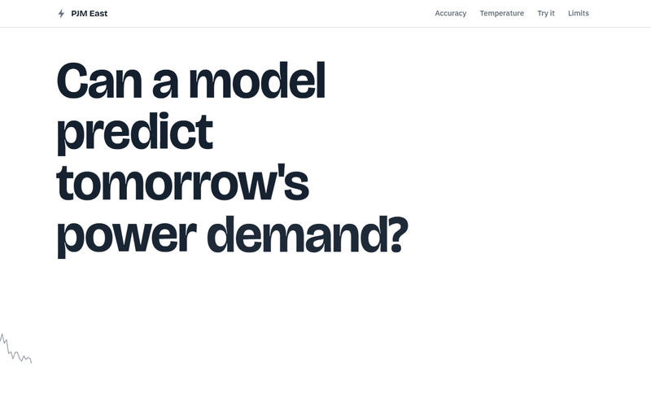
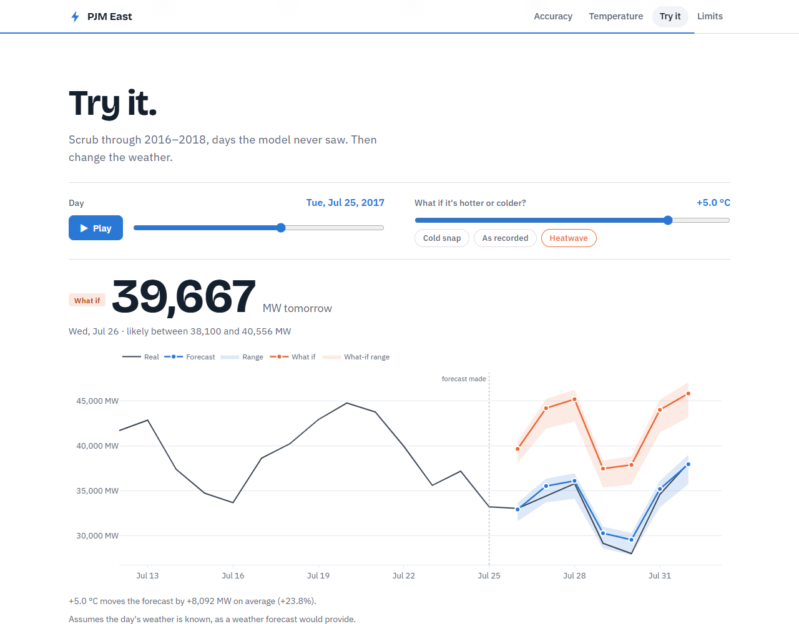
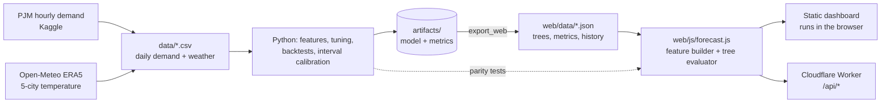

# PJM East Energy Demand Forecast

Seven-day electricity demand forecasts for the PJM East grid region, with calibrated prediction intervals, a
what-if weather scenario tool and a public API. The model is trained in Python and **runs in JavaScript on
Cloudflare**: the dashboard evaluates it in your browser and a Cloudflare Worker serves the same code as an API.



<sub>The site is a short scroll-driven story. Scrolling plays the animation: the model's line draws over real demand while the
miss counts up, then the temperature curve sweeps from cold to hot.</sub>



<sub>The interactive part: scrub through days the model never saw, or ask what a heatwave would do
([dark mode](docs/dashboard-dark.png)).</sub>

<!-- Add after deploying:  **Live demo:** https://<your-worker>.workers.dev -->

## Results

Measured on a chronological hold-out of **905 days (2016-02-10 → 2018-08-02)** that no model saw during fitting or
tuning. All models share the same train/test split.

| Model | MAPE | RMSE (MW) | MAE (MW) | R² |
|---|---:|---:|---:|---:|
| **Gradient boosting + weather (final)** | **2.14 %** | **832** | **662** | **0.970** |
| Ridge regression with degree-day terms | 3.14 % | 1,184 | 956 | 0.940 |
| Gradient boosting, no weather (ablation) | 4.42 % | 1,871 | 1,399 | 0.849 |
| Gradient boosting, calendar + lags (the v1 model) | 4.74 % | 1,971 | 1,493 | 0.833 |
| Naive: same as yesterday | 5.91 % | 2,428 | 1,841 | 0.746 |
| Seasonal naive: same weekday last week | 9.92 % | 4,298 | 3,173 | 0.205 |

- RMSE is **66 % lower than the "same as yesterday" baseline** and **56 % lower than the same model without temperature**.
- **Stable over time.** A walk-forward backtest (retrain before each year, score that year) gives 1.7–2.2 % MAPE for every
  year from 2008 to 2018, against 5.2–6.5 % for the naive baseline.
- **Multi-day forecasts** (recursive, 1–7 days ahead):

  | Days ahead | MAPE, weather known | MAPE, only normal weather assumed | 80 % interval coverage (known / normal) |
  |---:|---:|---:|---:|
  | 1 | 2.15 % | 6.04 % | 81 % / 75 % |
  | 3 | 2.99 % | 7.68 % | 83 % / 78 % |
  | 7 | 3.34 % | 7.99 % | 82 % / 78 % |

### What these numbers do and don't mean

- The headline accuracy **assumes the day's temperature is known**, the way a weather forecast would supply it. The model
  was evaluated with observed temperatures, which is slightly optimistic for real use. The right-hand column shows the
  other extreme: with no weather information at all, the model is no better than "same as yesterday" for the next day
  (6.0 % vs 5.9 %), but it still beats "same weekday last week" at every horizon.
- Intervals are calibrated on a two-year window *before* the hold-out, so the coverage figures are out-of-sample. They are
  close to the nominal 80 % when weather is known and up to about 5 points short when it is assumed.

## Architecture



Python is the source of truth for training and for the feature definitions. A gradient-boosting model is just a list of
decision trees, so it is exported as JSON and evaluated by a small dependency-free JavaScript module. That module is
shared by the browser and the Worker, so the dashboard and the API cannot disagree. The whole site is static files plus
one Worker; there is no Python server to host.

**Keeping two implementations honest.** `tests/test_js_parity.py` runs the Python and JavaScript forecasters on dozens of
origins, weather modes and temperature shifts and requires agreement to 1e-9, including identical rejection of bad input.
That test found a real problem: a tree split sat exactly on the value of `sin(day of year)`, and numpy and V8 differ by
one bit there, so a forecast moved by 10 MW. Rounding the sine/cosine and rolling-mean features in the shared feature
builder makes every platform compute identical values.

## What's in it

**Modelling**
- 24 features: calendar and U.S. federal holidays; the day's temperature (mean/max/min, heating and cooling degree days,
  a 3-day average); demand 1, 2, 7 and 14 days back plus 7- and 28-day rolling means.
- `HistGradientBoostingRegressor` tuned by randomized search with `TimeSeriesSplit` (5 folds).
- Multi-day forecasts are **recursive**: each prediction feeds the next day's lag features. A vectorised implementation
  stacks hundreds of forecast origins into one padded frame, so a full multi-horizon backtest takes about a minute.
- **Prediction intervals** are per-horizon quantiles of relative error from a calibration window, then verified on the
  hold-out (split-conformal style). Intervals widen when weather is assumed instead of known.
- Explainability: permutation importance on the hold-out, and a demand-vs-temperature view showing the V-shape behind the
  degree-day features.

**Frontend** (`web/`, static HTML/CSS/ES modules): a short scroll-driven story, not a dashboard. Each scene has one idea and
one visual:
- **Intro:** the headline animates in word by word while a demand line draws itself.
- **Accuracy:** pinned while you scroll; scrolling draws the model's forecast over real demand and counts the
  average miss up to 2.1 %, against 5.9 % for repeating yesterday.
- **Temperature:** the demand-versus-temperature curve sweeps from cold to hot as you scroll (a canvas, so it stays smooth).
- **Try it:** the only interactive part. A timeline slider with **Play** scrubs through days the model never saw; one
  what-if slider (or *Cold snap* / *Heatwave*) re-runs the full 7-day forecast and the chart glides to the new answer.
- **Limits:** three plain sentences.

Light and dark themes, keyboard-accessible controls, responsive to phone width, and `prefers-reduced-motion` shows the
finished state with no animation.

**Backend** (`worker/`, Cloudflare Worker): `GET /api/forecast`, `POST /api/predict`, `GET /api/model`, `GET /api/health`,
with input validation (422 with the reason), CORS and cache headers.

**Quality**
- 47 Python tests: feature leakage (scrambling future demand must not change features), holiday logic, batched-vs-single
  recursion, forecast behaviour, JS-vs-Python parity, and **quality gates on the shipped model** (must beat baselines,
  intervals near nominal coverage).
- 15 Worker tests that run the real handler against the real exported data.
- GitHub Actions: ruff + pytest on Python 3.12/3.13 and Worker tests plus a `wrangler deploy --dry-run`.

## Quick start

```bash
npm install
npx wrangler dev                      # dashboard + API on http://localhost:8787
npm test                              # Worker API tests
```

Retraining and Python tooling:

```bash
pip install -r requirements-dev.txt
python -m energy_forecast.train       # tune, compare, backtest, calibrate (~4 min, no credentials needed)
python -m energy_forecast.export_web  # write web/data/*.json from the trained model
pytest                                # 47 tests, includes the JS parity checks (needs Node)
python -m energy_forecast.build_data  # optional: rebuild data/ from Kaggle + Open-Meteo (needs network)
```

Always re-run `export_web` after training; a test fails if `web/data` is older than the model in `artifacts/`.

### Deploy to Cloudflare

```bash
npx wrangler login
npx wrangler deploy
```

Or connect the GitHub repo through Cloudflare's Git integration (Workers Builds) with the deploy command
`npx wrangler deploy` and no build command. `wrangler.jsonc` serves `web/` as static assets and runs the Worker only
for `/api/*`. Cloudflare may notice `requirements.txt` and install the Python dependencies first; this site doesn't need
them, so that step is only wasted time.

### API examples

```bash
curl "https://<your-worker>.workers.dev/api/forecast?origin=2017-07-10&horizon=7&temp_shift_c=3"
```

```json
{
  "origin": "2017-07-10", "horizon": 7, "weather": "actual", "temp_shift_c": 3,
  "points": [
    {"date": "2017-07-11", "predicted_mw": 44049.3, "lower_mw": 42308.4, "upper_mw": 45035.7,
     "actual_mw": 39636.042, "temp_mean_c": 29.57, "weather_source": "observed"}
  ]
}
```

`POST /api/predict` takes your own last 28–60 days of demand and a temperature for the target day and returns a day-ahead
prediction with its interval. `weather=climatology` forecasts with normal seasonal weather instead of observed.

## Project structure

```
.
├── web/                       # the deployed site (static assets)
│   ├── index.html, css/       #   page and design tokens
│   ├── js/forecast.js         #   feature builder + tree evaluator (browser and Worker)
│   ├── js/app.js, charts.js   #   dashboard logic and Plotly charts
│   ├── data/                  #   exported model, metrics and history (generated)
│   └── tests/run_cases.mjs    #   Node runner used by the parity tests
├── worker/                    # Cloudflare Worker API + tests
├── wrangler.jsonc, package.json
├── energy_forecast/           # Python: data, features, models, evaluation, training, export
├── data/                      # pjme_daily.csv, weather_daily.csv
├── artifacts/                 # model.joblib, metrics.json, backtest and importance tables
├── tests/                     # Python tests (incl. JS parity)
├── app.py, dashboard/         # optional local Streamlit explorer (not deployed)
├── api/                       # optional FastAPI mirror of the Worker API (not deployed)
└── .github/workflows/ci.yml
```

`app.py` and `api/` are the original Python front end and API. They use the same forecaster and are kept as local
tools and as an independent check on the Worker; Streamlit itself cannot run on Cloudflare.

## Limitations and next steps

- **Weather forecasts are not wired in.** Production use needs a day-ahead temperature forecast; the model currently takes
  observed temperature (to measure the model in isolation) or climatology.
- **Data ends in August 2018.** Later shifts such as pandemic load changes, data centres, rooftop solar and electrification
  are not captured, and the app does not pull live data.
- **Daily average, not peak.** Grid operators also care about peak-hour load.
- **Five-city temperature index.** A load-weighted index over more stations, plus humidity and cloud cover, would help,
  especially on mild days near the 18 °C balance point, where the largest errors occur.
- **Region scope.** The source file is PJM East (`PJME_hourly.csv`), a sub-region of the PJM Interconnection.

The first version of this project scored 4.7 % MAPE with calendar and lag features only; it is the "v1" row above.

## Data and attributions

- Demand: PJM Interconnection hourly load via the Kaggle dataset
  ["Hourly Energy Consumption"](https://www.kaggle.com/datasets/robikscube/hourly-energy-consumption) (robikscube).
  The final, incomplete day in that file is dropped.
- Weather: [Open-Meteo.com](https://open-meteo.com/) historical weather API (ERA5 reanalysis, CC BY 4.0), blended across
  Philadelphia, Washington D.C., Baltimore, Newark and Harrisburg with approximate population weights.
- Charts: [Plotly.js](https://plotly.com/javascript/) basic bundle (MIT), vendored in `web/vendor/`.

## Tech stack

Python · pandas · scikit-learn · JavaScript (ES modules) · Cloudflare Workers · Plotly.js · pytest · Node test runner · ruff ·
GitHub Actions · Streamlit and FastAPI (optional local tools)
