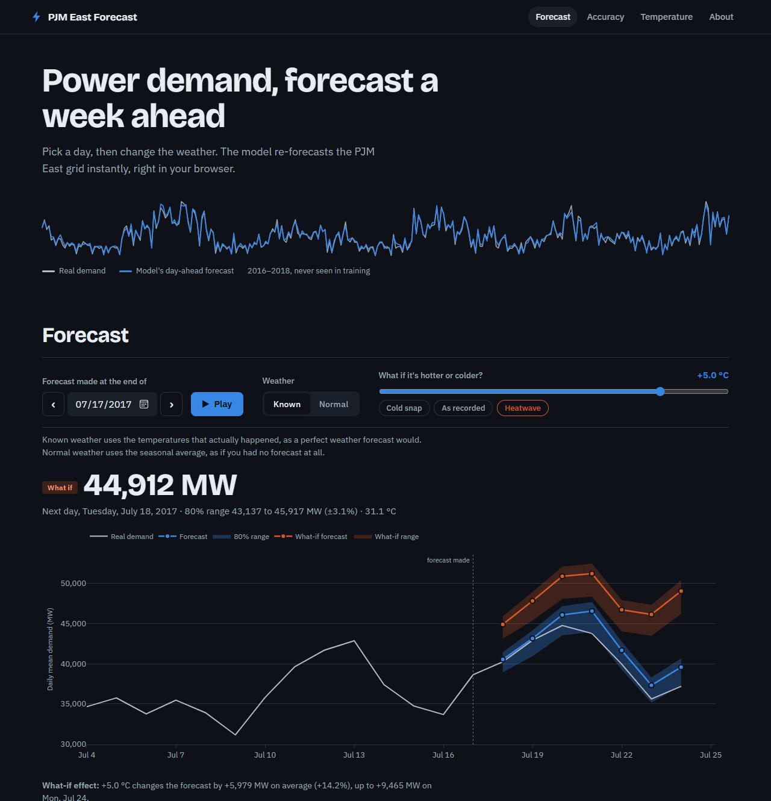
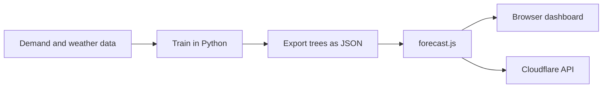

<div align="center">

# PJM Energy Demand Forecast

**Seven-day electricity demand forecasts with honest error bars. Trained in Python, running in JavaScript.**

[](https://energy-prediction-mll.wm-waleedmaqbool.workers.dev)


<br>


</div>

<br>

For the PJM East grid region, this predicts daily electricity demand up to seven days ahead, with calibrated prediction intervals, a what-if weather tool and a public API. The gradient-boosting model is exported as JSON trees, so the **dashboard evaluates it in your browser and a Cloudflare Worker serves the same code as an API**. There is no Python server to host.

<div align="center">


</div>

## Results

Measured on a chronological hold-out of **905 days (2016-02-10 to 2018-08-02)** that no model saw during fitting or tuning.

| Model | MAPE | RMSE (MW) | R² |
|---|---:|---:|---:|
| **Gradient boosting with weather (final)** | **2.14%** | **832** | **0.970** |
| Ridge regression with degree-day terms | 3.14% | 1,184 | 0.940 |
| Gradient boosting, no weather | 4.42% | 1,871 | 0.849 |
| Gradient boosting, calendar and lags (v1) | 4.74% | 1,971 | 0.833 |
| Naive: same as yesterday | 5.91% | 2,428 | 0.746 |
| Naive: same weekday last week | 9.92% | 4,298 | 0.205 |

- RMSE is **66% lower** than the "same as yesterday" baseline and **56% lower** than the same model without temperature.
- **Stable over time.** A walk-forward backtest gives 1.7 to 2.2% MAPE in every year from 2008 to 2018, against 5.2 to 6.5% for the naive baseline.

### Further ahead

Forecasts are recursive: each day feeds the next. The right-hand columns show the cost of not knowing the weather.

| Days ahead | MAPE, weather known | MAPE, normal weather assumed | 80% interval coverage |
|---:|---:|---:|---:|
| 1 | 2.15% | 6.04% | 81% / 75% |
| 3 | 2.99% | 7.68% | 83% / 78% |
| 7 | 3.34% | 7.99% | 82% / 78% |

<sub>Coverage is shown as known weather / assumed weather.</sub>

> **What the numbers do and do not mean.** The headline figure assumes the day's temperature is known, as a weather forecast would supply it, so it is slightly optimistic for real use. With no weather information the model is no better than "same as yesterday" for the next day (6.0% vs 5.9%), though it still beats "same weekday last week" at every horizon. Intervals are calibrated on a two-year window before the hold-out, so coverage is measured out of sample.

## How it works



Python is the source of truth for training and for feature definitions. A gradient-boosting model is just a list of decision trees, so a small dependency-free JavaScript module evaluates it, and that module is shared by the browser and the Worker. The dashboard and the API cannot disagree.

**Keeping two implementations honest.** `tests/test_js_parity.py` runs both forecasters on dozens of cases and requires agreement to 1e-9. It caught a real bug: a tree split sat exactly on `sin(day of year)`, numpy and V8 differ by one bit there, and a forecast moved by 10 MW. Rounding those features fixed it on every platform.

The model uses 24 features (calendar and holidays, the day's temperature and degree days, and demand lagged 1, 2, 7 and 14 days with rolling means), tuned with `TimeSeriesSplit`.

## API

| Endpoint | Does |
|---|---|
| `GET /api/forecast` | Forecast from an origin date, 1 to 7 days, with an optional temperature shift |
| `POST /api/predict` | Day-ahead prediction from your own last 28 to 60 days of demand |
| `GET /api/model` | Model metadata and metrics |
| `GET /api/health` | Health check |

```bash
curl "https://energy-prediction-mll.wm-waleedmaqbool.workers.dev/api/forecast?origin=2017-07-10&horizon=7&temp_shift_c=3"
```

## Run it

```bash
npm install
npx wrangler dev        # dashboard and API at http://localhost:8787
npm test                # Worker API tests
```

To retrain: `pip install -r requirements-dev.txt`, then `python -m energy_forecast.train` (about 4 minutes, no credentials) and `python -m energy_forecast.export_web`. `pytest` runs the 47 Python tests, including the JavaScript parity checks, and needs Node. CI runs ruff, pytest and a `wrangler deploy --dry-run`.

## Honest limits

- No weather forecast is wired in. The model takes observed temperature or normal-season weather.
- The data ends in August 2018, so later shifts such as pandemic load changes, data centers and rooftop solar are not captured.
- It predicts the daily average, not the peak hour.
- Temperature is a five-city index, and the largest errors come on mild days near 18 degrees C.
- The source is PJM East, a sub-region of the PJM Interconnection.

## Data

Demand: PJM hourly load via the Kaggle dataset ["Hourly Energy Consumption"](https://www.kaggle.com/datasets/robikscube/hourly-energy-consumption) (robikscube). Weather: [Open-Meteo](https://open-meteo.com/) historical API (ERA5, CC BY 4.0), blended across Philadelphia, Washington D.C., Baltimore, Newark and Harrisburg. Charts: [Plotly.js](https://plotly.com/javascript/) (MIT).
